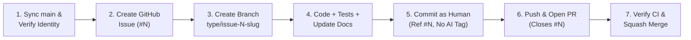

# BruinBuddy — Agentic Git & Team Collaboration Guide

This document defines the mandatory collaboration workflow for **BruinBuddy**. Because several team members are not proficient with Git, **every AI coding agent is responsible for executing the entire Git and GitHub lifecycle end-to-end** on behalf of the human teammate.

Linked from: [CLAUDE.md](../CLAUDE.md) · [.claude/README.md](README.md) · [git-workflow-manager agent](agents/git-workflow-manager.md)

---

## 1. Golden Rule: Human-Only Contributor Attribution

> **CRITICAL REQUIREMENT:** Every Git commit, branch, issue, and pull request must be attributed **exclusively to the human team member** (e.g., `Nivesh`), **NEVER** to Claude or any AI assistant.

1. **No AI Co-Author Trailers:** Never include `Co-authored-by: Claude <noreply@anthropic.com>` or any similar trailer in commit messages.
2. **No AI Signatures in PRs or Issues:** Never include `🤖 Generated with Claude Code` or similar footers in pull request descriptions, issue bodies, or comments.
3. **Verify Git Author Before Committing:**
   ```bash
   git config user.name
   git config user.email
   ```
   - For Nivesh's workstation, `user.name` must be `Nivesh` (`kenivesh@gmail.com`).
   - For any other teammate's workstation, ensure `user.name` and `user.email` match their GitHub account before creating the first commit.
   - Always omit `--author="Claude..."` and rely on `.claude/settings.json` (`"includeCoAuthoredBy": false`, `"attribution": {"commit": "", "pr": ""}`).

---

## 2. How Non-Git Team Members Work With Their AI Agent

Team members do **not** need to run Git commands manually. They simply tell their AI agent what they want in plain language:

| What the teammate says | What the AI agent does automatically |
|---|---|
| *"I want to start working on [feature/bug]"* or `/project:start-task` | Syncs `main`, creates a GitHub Issue (`#N`), creates branch `<type>/issue-N-<slug>`, and switches to it. |
| *"Save my progress"* | Stages only the specific modified files, runs tests, and creates a clean commit attributed to the teammate referencing `(#N)`. |
| *"Ship / publish / merge my work"* or `/project:ship` | Runs backend `pytest` + frontend `npm run build`, pushes the branch, opens a PR linked to `#N` (`Closes #N`), waits for CI checks to pass, and merges the PR cleanly into `main`. |
| *"Sync my repo with the team"* | Stashes any uncommitted work safely, pulls latest `main`, and rebases/merges cleanly. |
| *"Something broke / undo my last change"* | Inspects `git status` and `git diff` and restores files safely without losing untracked personal notes. |

---

## 3. The 7-Step End-to-End Agentic Workflow

Whenever a user asks to build a feature, fix a bug, or update documentation/configuration, the AI agent **must** follow these 7 steps in order:



### Step 1: Pre-Flight Identity & Sync Check
Before starting a new task, ensure the working tree is clean, Git identity is set to the human contributor, and `main` is up to date:
```bash
git config user.name    # Must be the human contributor (e.g., Nivesh), never Claude
git config user.email   # Must match the human's GitHub email
gh auth status          # Confirm GitHub CLI authentication is active
git checkout main
git pull origin main
```

### Step 2: Create a GitHub Issue (`gh issue create`)
Every piece of work starts with a tracked GitHub Issue so the entire team has visibility:
```bash
gh issue create \
  --title "<type>: <concise summary of task>" \
  --body "## Context
<Why this change is needed>

## Scope & Acceptance Criteria
- [ ] <Criterion 1>
- [ ] <Criterion 2>
- [ ] Backend tests (\`pytest\`) and frontend build (\`npm run build\`) pass"
```
Record the created issue number (e.g., `#14`).

### Step 3: Create an Issue-Linked Branch
Never commit directly to `main`. Create a descriptive branch that includes the issue number:
```bash
git checkout -b <type>/issue-<N>-<short-slug>
```
**Branch Naming Prefixes (`<type>`):**
- `feat/issue-<N>-<slug>` — New user-facing or staff-facing feature
- `fix/issue-<N>-<slug>` — Bug fix or regression fix
- `docs/issue-<N>-<slug>` — Documentation, `CLAUDE.md`, or `.claude/` updates
- `chore/issue-<N>-<slug>` — Tooling, tests, refactoring, or dependency maintenance

### Step 4: Implement Changes, Run Tests & Update Docs
1. Respect all invariants in [CLAUDE.md](../CLAUDE.md) (tenancy, solution leak protection, gate ordering, Stripe activation, portable SQL, explicit usage attribution).
2. Run the backend test suite (98+ tests, mock LLM, temp SQLite DB):
   ```bash
   cd backend && ../backend/.venv/bin/python -m pytest -q
   ```
3. If frontend files changed, verify the production bundle builds cleanly:
   ```bash
   cd frontend && npm run build
   ```
4. Update matching documentation in `docs/` (`TECHNICAL.md`, `AI_STRATEGY.md`, `DESIGN.md`, `PRD.md`) and `.claude/memory/` in the same branch.

### Step 5: Stage by Path & Commit (Human Attribution Only)
- **Never** run `git add -A` or `git add .` (team members keep untracked local notes, `.env`, `data/`, and `18.05-spring-2022/` in their workspace).
- Stage files explicitly by path and reference the issue number `(#N)`:
```bash
git add path/to/file1 path/to/file2
git commit -m "<type>: <clear description of change> (#<N>)"
```
- Double-check `git log -1 --format="%an <%ae>%n%B"` to verify:
  - Author is the human contributor (e.g., `Nivesh <kenivesh@gmail.com>`).
  - Commit body contains **no** `Co-authored-by: Claude` or AI footer.

### Step 6: Push Branch & Create Linked Pull Request (`gh pr create`)
Push the feature branch and open a Pull Request that explicitly links and closes the issue (`Closes #<N>`):
```bash
git push -u origin <type>/issue-<N>-<short-slug>

gh pr create \
  --base main \
  --head <type>/issue-<N>-<short-slug> \
  --title "<type>: <concise summary> (#<N>)" \
  --body "## Summary
Closes #<N>

- <Bullet 1 describing what changed and why>
- <Bullet 2>

## Verification
- [x] \`pytest -q\` passed
- [x] \`npm run build\` succeeded
- [x] Documentation updated"
```

### Step 7: Verify CI Checks & Merge the Pull Request
> **Production Deploy Note:** Merging into `main` triggers production deployment (GitHub Actions runs tests + deploys backend to Fly.io; Vercel rebuilds frontend). Always ensure CI checks pass before merging, and confirm with the user when merging production code changes.

```bash
# 1. Watch CI checks on the PR until backend-tests and frontend-build pass
gh pr checks <PR_NUMBER> --watch

# 2. Squash-merge the PR into main and delete the remote branch
gh pr merge <PR_NUMBER> --squash --delete-branch

# 3. Return local workspace to the updated main branch
git checkout main
git pull origin main
```
Because the PR description includes `Closes #<N>`, GitHub automatically links the PR to Issue `#<N>` and closes the issue upon merge.

---

## 4. Handling Common Team Scenarios

### Scenario A: Teammate Started Editing Files Directly on `main`
If a teammate edited files before asking the agent to start a task:
1. Do **not** discard their changes.
2. Run `git status` to see modified files.
3. Create the GitHub Issue (`#N`) first via `gh issue create`.
4. Run `git checkout -b <type>/issue-<N>-<slug>` (this carries uncommitted edits onto the new branch without touching `main`).
5. Continue from **Step 4** above.

### Scenario B: Branch Has Merge Conflicts with `main`
If `main` moved ahead while a branch was in progress:
```bash
git fetch origin main
git rebase origin/main
```
If conflicts arise, inspect each conflicted file, resolve in favor of preserving both features and all security/tenancy invariants in `CLAUDE.md`, re-run `pytest -q` and `npm run build`, then `git rebase --continue`.

### Scenario C: Authentication Hang on Windows / macOS
If `git push` or `git pull` hangs waiting for a credential popup, configure Git to use the authenticated GitHub CLI credential helper:
```bash
git config credential.helper "!gh auth git-credential"
```
