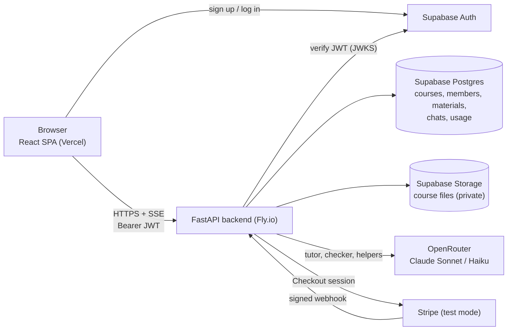

# BruinBuddy

An AI tutor for a university course. A professor (or the university) pays for a course, uploads the course materials and sets the rules; students join free with a course code and get a tutor that answers from those materials, cites them, and guides them through problem sets without handing over graded answers.

**v1** (this branch) adds real accounts (Supabase Auth), paid courses (Stripe Checkout in test mode), professor uploads, per-problem-set modes (Graded / Practice / Solutions open), teaching guidelines, exam pauses, token allowances, a course home with review and quiz chats, and an aggregate-only staff dashboard. The demo course is MIT OCW 18.05 (Probability and Statistics) standing in for a UCLA course.

Docs: [PRD (v1)](docs/PRD.md) · [Design](docs/DESIGN.md) · [Technical architecture](docs/TECHNICAL.md) · [AI strategy](docs/AI_STRATEGY.md) · [PRD v0](docs/PRD_v0.md)

## Architecture

Inside the backend, each course has its own BM25 index over the materials students may see and a leak guard over the solutions they may not; the tutor pipeline is retrieve → (check the attempt against the solution) → generate → guard → cite. See [TECHNICAL.md](docs/TECHNICAL.md) §1, §7–9.

## Run it locally
Needs Python 3.12+ and Node 18+. Local mode uses email + password accounts stored on your machine and a built-in test checkout page, so no Supabase or Stripe keys are needed.

```bash
# 1. Configure (add your OpenRouter key; leave the auth and Stripe settings empty for local mode)
cp .env.example .env

# 2. Backend
python3 -m venv backend/.venv
backend/.venv/bin/pip install -r backend/requirements-dev.txt

# 3. Frontend (built once; the backend serves it)
cd frontend && npm install && npm run build && cd ..

# 4. Start
backend/.venv/bin/python -m uvicorn app.main:app --app-dir backend --port 8000
```
Open http://127.0.0.1:8000, create an account, and either create a course (pay on the test checkout page) or join one with a code.

**The 18.05 demo course** (optional). Download the course from MIT OpenCourseWare (https://ocw.mit.edu/courses/18-05-introduction-to-probability-and-statistics-spring-2022/download/), unzip it, and put the folder at the repo root as `18.05-spring-2022/` (git-ignored; it should contain `resources/` and `static_resources/`). Then:
```bash
cd backend
../backend/.venv/bin/python -m app.ingest --owner-email you@example.edu   # creates the course; prints a password for a new local account
../backend/.venv/bin/python -m app.seed                                    # sample students and questions for the dashboard
```

- **No OpenRouter key?** Set `BB_MOCK_LLM=1` to try everything with a fake tutor (no cost, not real answers).
- **Frontend dev server:** `cd frontend && npm run dev` (port 5173, proxies to the backend on 8000).
- **Tests:** `cd backend && ../backend/.venv/bin/python -m pytest` (105 tests on a synthetic course with a mock model; no keys or course export needed). They also run in GitHub Actions on pull requests and before every deploy. Set `TEST_DATABASE_URL` to run them against a throw-away Postgres.
- **Coming from v0?** The first start migrates the local database in place (v0 users and chats are kept as `v0_*` tables). Then run the ingest command above to attach the 18.05 materials to the demo course.
- **Leak check with the real model:** `cd backend && ../backend/.venv/bin/python -m app.evals --course-id 1 --pset "Problem Set 04"` sends 10 pressure prompts to a Graded set and reports any solution text that got through (about $0.15).
- Spend is logged per call, with course and student, in the `usage_log` table.

## Contributing
- **Never push to `main`: it deploys production** (backend via GitHub Actions, frontend via Vercel). GitHub can't enforce this on our private repo, so work on a branch and open a pull request; CI runs the tests and the frontend build on every PR, and the repo owner merges.
- Add or update tests with each change (`cd backend && ../backend/.venv/bin/python -m pytest`). They use a fake model and a temporary database, so they need no keys.
- When behaviour changes, update the matching doc in `docs/` in the same PR.
- Use `BB_MOCK_LLM=1` by default. Real model calls cost money; for real answers, use your own OpenRouter key in your own `.env`.
- Never commit `.env` files or keys. Production settings live in Fly secrets, which only the repo owner manages.
- **Using Claude Code?** [CLAUDE.md](CLAUDE.md) gives it the commands, a map of the code and the rules that must not break (tenancy, solution protection, payments, portable SQL). Claude reads it automatically.

## Deploy
Production: Vercel (frontend) + Fly.io (backend) + Supabase (Postgres, Storage, Auth) + Stripe (test mode). Live v1: https://bruinbuddy.vercel.app (frontend) and https://bruinbuddy-api.fly.dev (backend). A push to `main` redeploys both: the backend through GitHub Actions (tests first, then `flyctl deploy`) and the frontend through Vercel's GitHub integration. See [TECHNICAL.md](docs/TECHNICAL.md) §17.

### v1 go-live checklist
Done for the live site on 2026-10-20; kept for setting up another environment. The v1 backend refuses to start in production until Supabase Auth and Stripe are configured, so do steps 1–3 **before** merging to `main`. Settings that already exist from v0 (database, OpenRouter, Storage, `SECRET_KEY`, `ALLOWED_ORIGINS`) stay as they are.

1. **Supabase Auth** (Supabase dashboard → Authentication)
   - *Sign In / Providers → Email:* turn off **Confirm email** for the demo (Supabase's built-in mailer only sends to project members and is rate-limited), or set up custom SMTP and leave it on.
   - *URL Configuration:* Site URL `https://bruinbuddy.vercel.app`; add redirect URLs `https://bruinbuddy.vercel.app/**` and `http://localhost:5173/**`. Password-reset and Google links return here.
   - *Optional, Google sign-in:* create an OAuth client in Google Cloud (authorized redirect URI `https://<project-ref>.supabase.co/auth/v1/callback`) and enable the Google provider with its ID and secret. The "Continue with Google" button appears automatically.
   - Copy the **anon / publishable key** (Project Settings → API Keys). It's public by design.
2. **Stripe** (dashboard in **test mode**)
   - Developers → API keys: copy the **secret key** (`sk_test_…`).
   - Developers → Webhooks → Add endpoint `https://bruinbuddy-api.fly.dev/api/stripe/webhook` with events `checkout.session.completed` and `checkout.session.async_payment_succeeded`; copy its **signing secret** (`whsec_…`).
3. **Fly secrets** (restarts the running v0 app, which ignores the new settings):
   ```bash
   fly secrets set -a bruinbuddy-api AUTH_PROVIDER=supabase SUPABASE_ANON_KEY=<anon key> STRIPE_SECRET_KEY=sk_test_... STRIPE_WEBHOOK_SECRET=whsec_... APP_URL=https://bruinbuddy.vercel.app
   ```
   ```bash
   fly secrets unset -a bruinbuddy-api STUDENT_CODE PROFESSOR_CODE DAILY_MESSAGE_LIMIT
   ```
   Keep `.env.production` in step with these (template: `.env.production.example`).
4. **Merge `v1-build` into `main`.** GitHub Actions runs the tests and deploys; on first start the backend migrates the Supabase database in place (v0 users and chats are kept as `v0_*` tables). Vercel redeploys the frontend; it needs no new settings.
5. **Claim the demo course.** Sign up on the live site with your email, then from this machine:
   ```bash
   cd backend && DATABASE_URL='<transaction pooler URL>' AUTH_PROVIDER=supabase ../backend/.venv/bin/python -m app.ingest --owner-email you@ucla.edu
   ```
   Optionally add dashboard sample data with `python -m app.seed` the same way. Both are safe to re-run.
6. **Smoke test:** create a course and pay with card `4242 4242 4242 4242`; join it from a second account with the code; upload a PDF; ask a question; check the dashboard.

Course content: MIT OpenCourseWare 18.05, Spring 2022, CC BY-NC-SA 4.0. Non-commercial use only. Not affiliated with MIT or UCLA.
